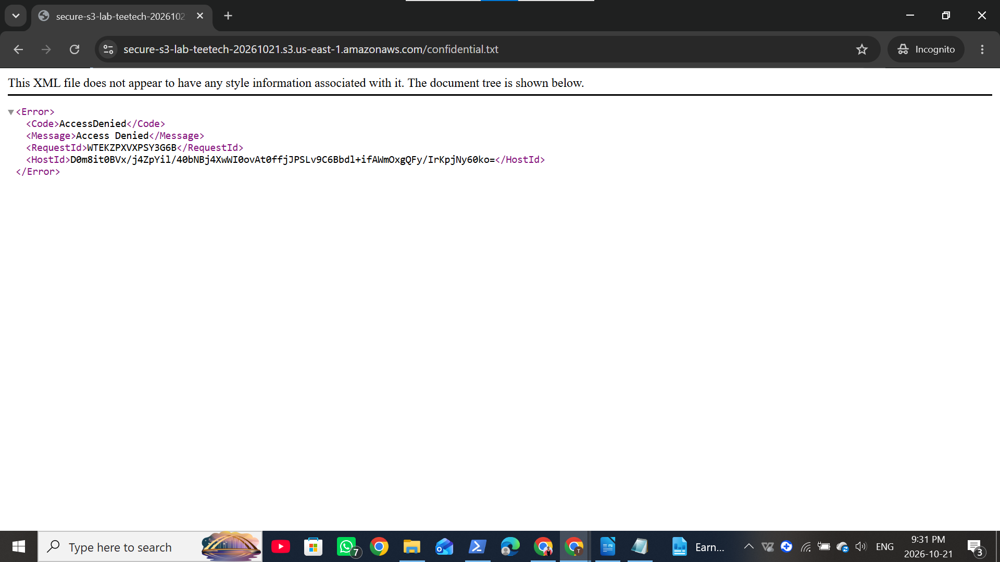

 Phase C: Encryption and Access Control

Objective

Upload an object using SSE-KMS, configure scoped S3 permissions, and test anonymous access.

Environment

| Component | Configuration |
|---|---|
| Bucket | secure-s3-lab-teetech-20261021 |
| Region | us-east-1 |
| Object | confidential.txt |
| CLI profile | personal-sandbox |
| Verified IAM identity | ops-user |
| KMS alias | alias/S3LabKey |
| Public access protection | All four Block Public Access settings enabled |
| ACLs | Disabled |

Actions Taken

 Identity and Key Access

I verified the identity used by the personal-sandbox profile:

```powershell
aws sts get-caller-identity --profile personal-sandbox
```

The returned ARN identified ops-user.

The KMS key initially listed Cloud-security-lab-admin for key access. I added ops-user under S3LabKey's key users to authorize its use during encryption testing.

Create a Sample File

```powershell
"Simulated confidential data for Task 10 encryption testing." | Set-Content .\confidential.txt
```

The file contained dummy data only.

 Upload with SSE-KMS

```powershell
aws s3 cp .\confidential.txt s3://secure-s3-lab-teetech-20261021/confidential.txt --sse aws:kms --sse-kms-key-id alias/S3LabKey --region us-east-1 --profile personal-sandbox
```

Actual result:

```text
upload: .\confidential.txt to s3://secure-s3-lab-teetech-20261021/confidential.txt
```

Verify Object Encryption

```powershell
aws s3api head-object --bucket secure-s3-lab-teetech-20261021 --key confidential.txt --region us-east-1 --profile personal-sandbox --query "{Encryption:ServerSideEncryption,KMSKey:SSEKMSKeyId}" --output json
```

The actual verification output is recorded in PhaseC_Encryption.log. The ServerSideEncryption value should be aws:kms, with the KMS key ARN identifying the key used.

This upload explicitly selected SSE-KMS for the object. It did not change the bucket's default encryption from SSE-S3.

Apply Scoped Bucket Permissions

I opened:

S3 → secure-s3-lab-teetech-20261021 → Permissions → Bucket policy → Edit

I applied separate statements granting the verified ops-user ARN:

- s3:ListBucket on the bucket ARN.
- s3:GetObject and s3:PutObject on the bucket's object ARN scope.

Both Principal entries used the complete ARN returned by STS.

The task's example used s3:*, so I narrowed the grant to the operations required for this test. I also included a bucket-level resource for ListBucket.

Block All Public Access remained enabled.

 Test Anonymous Access

I copied confidential.txt's direct Object URL and opened it in an Incognito/InPrivate browser window without using a presigned URL.

Actual result:

```text
AccessDenied
```

 Troubleshooting

| Issue | Resolution |
|---|---|
| Cloud-security-lab-admin was not a configured CLI profile | Listed available profiles and verified personal-sandbox |
| STS endpoint connection failed | Retried and successfully verified the identity |
| HeadObject returned 404 before upload | Uploaded the sample object, then repeated verification |
| Policy editor rejected placeholder Principal values | Replaced both placeholders with the complete verified IAM user ARN |

Key Observations

SSE-KMS requires appropriate S3 and KMS permissions. The successful upload demonstrated that the tested identity could perform this encrypted upload.

Object-level encryption can be selected explicitly without changing the bucket's default encryption configuration.

The bucket policy grants scoped access to ops-user, but does not remove permissions granted through other policies. It therefore does not establish exclusive access or prove that the identity's overall effective permissions are least privilege.

Anonymous AccessDenied confirms that the tested request failed. Because multiple protective controls were active, this result does not isolate which control caused the denial.

An SSE-KMS object download and a second-identity access test were not performed during this phase.

Evidence

- [Upload and encryption verification log](PhaseC_Encryption.log)
- [Anonymous access denied](PhaseC_AnonymousDenied.png)

Figure 1: Anonymous Access Test



The direct object URL returned AccessDenied in a private browser session.

 Validation Summary

| Check | Result |
|---|---|
| IAM identity verified | ops-user |
| SSE-KMS upload | Successful |
| Object encryption verification | Actual output retained in PhaseC_Encryption.log |
| Scoped bucket policy | Saved successfully |
| Anonymous browser request | AccessDenied |
| SSE-KMS download | Not tested |
| Exclusive access for ops-user | Not established |

References

- [Using SSE-KMS with Amazon S3](https://docs.aws.amazon.com/AmazonS3/latest/userguide/UsingKMSEncryption.html)
- [S3 Policies and Permissions](https://docs.aws.amazon.com/AmazonS3/latest/userguide/access-policy-language-overview.html)
