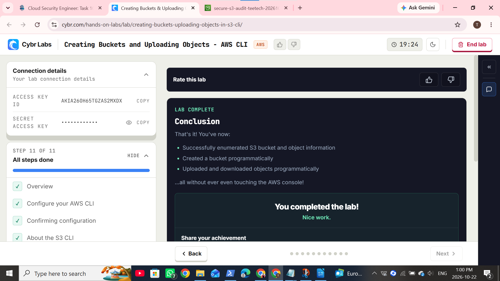

Phase E: Hosted Labs Integration

Objective

Reinforce S3 CLI operations and encryption concepts through hosted labs.

Lab Status

| Lab | Status |
|---|---|
| Cybr: Creating Buckets & Uploading Objects in S3 (CLI) | Completed |
| Cybr: Encrypting S3 Data with SSE-KMS – CLI | Not completed — premium access required |

Actions Taken

I completed the first lab using Windows PowerShell and AWS CLI version 2.36.49.

I used the named profile cybr-s3-cli to separate the hosted-lab credentials from my personal AWS credentials.

I created the bucket using:

```powershell
aws s3api create-bucket --bucket our-new-bucket-cybr --region us-east-1 --profile cybr-s3-cli --endpoint-url https://s3.us-east-1.amazonaws.com
```

Actual output:

```json
{
  "Location": "/our-new-bucket-cybr",
  "BucketArn": "arn:aws:s3:::our-new-bucket-cybr"
}
```

I continued through the lab activities covering bucket listing, ACL and encryption inspection, object upload and download, and object attributes.

Commands used included:

```powershell
aws s3api list-buckets --profile cybr-s3-cli --region us-east-1 --endpoint-url https://s3.us-east-1.amazonaws.com
```

```powershell
aws s3api get-bucket-acl --bucket our-new-bucket-cybr --profile cybr-s3-cli --region us-east-1 --endpoint-url https://s3.us-east-1.amazonaws.com
```

An initial endpoint connection failure was resolved by retrying with the regional endpoint.

The second lab required premium access. I recorded this limitation and referenced my personal homelab's SSE-KMS upload, download and encryption-verification evidence as related reinforcement. This does not constitute completion of the second hosted lab.

Key Observations

Bucket configuration and object attributes provide different information and require separate inspection.

Named profiles helped keep hosted-lab and personal credentials distinct.

Endpoint connection failures needed separate troubleshooting from permission errors.

Evidence



**Figure 1:** Completion confirmation for Creating Buckets & Uploading Objects in S3 (CLI).

 Related Homelab Evidence

- [Phase C: Encryption and Access Control](../Phase-C-Encryption-Access-Control/README.md)
- [Phase D: Object Permissions and Logging](../Phase-D-Object-Permissions-Logging/README.md)

References

- [Cybr: Creating Buckets & Uploading Objects in S3 (CLI)](https://cybr.com/hands-on-labs/lab/creating-buckets-uploading-objects-in-s3-cli/)
- [Cybr: Encrypting S3 Data with SSE-KMS – CLI](https://cybr.com/hands-on-labs/lab/encrypting-s3-data-with-sse-kms-cli/)
