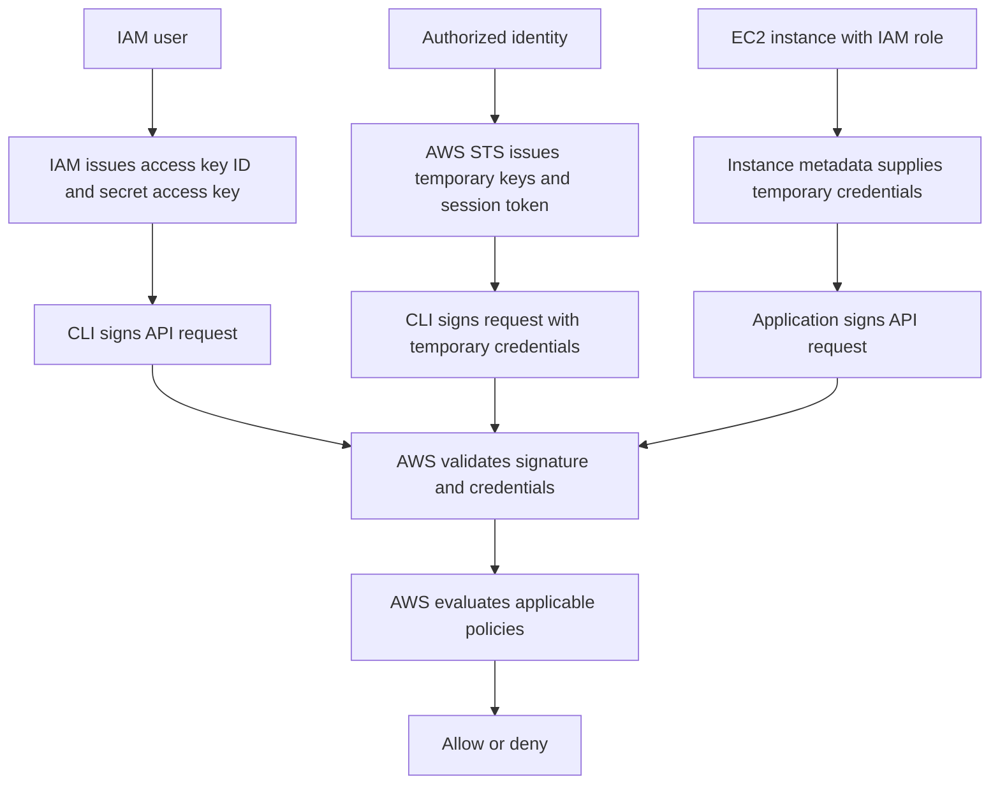

Phase A: Theory & Introduction

Objective
Understand the types of AWS credentials, how they are issued and validated, and their security implications.

Actions Taken
- Reviewed IAM user access keys, temporary AWS STS credentials and EC2 instance roles.
- Compared the exposure risks of long-lived and short-lived credentials.
- Ran `aws sts get-caller-identity` to verify my current AWS CLI identity.

Credential Flow Diagram



Identity Verification

Command:

```powershell
aws sts get-caller-identity
```

Output, with identifiers redacted:

```json
{
    "UserId": "[REDACTED]",
    "Account": "[REDACTED]",
    "Arn": "arn:aws:iam::[REDACTED]:user/s3user"
}
```

The command succeeded and confirmed that the CLI was acting as the IAM user `s3user`. This output identifies the caller but does not establish whether long-lived keys or temporary IAM-user session credentials were used.

Troubleshooting

I also attempted:

```powershell
aws sts get-caller-identity --profile s3user
```

This returned:

```text
The config profile (s3user) could not be found
```

The IAM username did not correspond to a configured local CLI profile. I continued using the successful command without specifying a profile.

Credential Comparison

| Credential type | Issuance and lifetime | Security implications |
|---|---|---|
| IAM user access keys | Created for an IAM user; do not automatically expire. | Leaked keys remain usable until deactivated or deleted, subject to applicable permissions. |
| Temporary STS credentials | STS issues an access key ID, secret access key and session token with an expiration time. | Expiration limits the exposure window, but stolen credentials can still be misused while valid. |
| EC2 instance role credentials | An instance profile associates a role with EC2; temporary credentials are delivered through instance metadata and automatically refreshed. | Avoids storing permanent keys on the instance. Instance security and least-privilege role permissions remain essential. |

Key Learning
Credential lifetime and permissions both affect risk. Temporary credentials reduce persistent secret storage and limit the usefulness of stolen credentials. Least privilege is still necessary because temporary credentials can grant powerful access during their validity period.

 Evidence
Screenshot filename: `phaseA_identity.png`

The screenshot should show the credential-flow diagram and the successful identity command output.

 References
- [AWS security credentials](https://docs.aws.amazon.com/IAM/latest/UserGuide/security-creds.html)
- [Temporary security credentials](https://docs.aws.amazon.com/IAM/latest/UserGuide/id_credentials_temp.html)
- [Using temporary credentials with EC2](https://docs.aws.amazon.com/IAM/latest/UserGuide/id_credentials_temp_use-resources.html)
