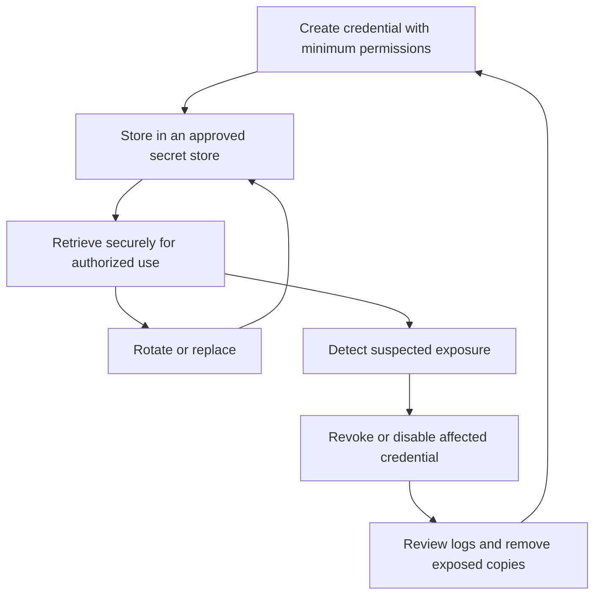

 Phase D: Independent Extension — Secret Lifecycle Analysis

 Objective
Map the lifecycle of potential exposed secrets and propose controls for secure creation, storage, usage, rotation and revocation.

 Evidence Basis and Limitations
This analysis uses selected findings from the Phase C TruffleHog scan of SecLists.

TruffleHog reported 13,519 unverified detections. Credential verification was disabled, and no active credential leak has been confirmed. Gitleaks completion remains unconfirmed.

The lifecycle controls and risk ratings below are proposed scenarios, not claims that these exposures occurred.

Actions Taken
- Reviewed selected detector types, file paths and commit identifiers from the TruffleHog report.
- Identified repeated detector/file combinations across historical commits.
- Inspected samples from the current Flarum and Shopware wordlists.
- Mapped a recommended secret lifecycle.
- Created a provisional risk matrix covering three potential exposure scenarios.
- Documented mitigation recommendations and evidence gaps.

Findings Reviewed

| Detector | File location | Assessment |
|---|---|---|
| Eraser | Discovery/Web-Content/CMS/trickest-cms-wordlist/flarum.txt | Unverified pattern match |
| Eraser | Discovery/Web-Content/CMS/trickest-cms-wordlist/flarum-all-levels.txt | Unverified pattern match |
| YoutubeApiKey | Discovery/Web-Content/CMS/trickest-cms-wordlist/shopware.txt | Unverified API-key pattern match |
| YoutubeApiKey | Discovery/Web-Content/CMS/trickest-cms-wordlist/shopware-all-levels.txt | Unverified API-key pattern match |

Selected findings appeared in these commits:
- `3fdb381e424fba5a95a3ed6594b39db5aa217d05`
- `0b964a69bdd1ffdd780a7978eb91ac1ca432dcb6`
- `959a76a92667359ffa20229a1eb3f6eac990ad8e`

The supplied sample contained seven detection records across four files. These records do not establish seven unique secrets.

Lifecycle Assessment of Selected Findings

| Lifecycle element | Available evidence |
|---|---|
| Creation source | Unknown; detector names do not establish who created a value or why. |
| Storage location | Historical repository paths identified by TruffleHog. |
| Usage | Not established; no operational use was demonstrated. |
| Rotation policy | Not established from available evidence. |
| Revocation status | Unknown. |
| Credential validity | Unverified. |
| Context reviewed | Current file samples contain application filenames and directory paths. |

The reviewed samples are consistent with discovery wordlists. This suggests possible false positives, but the exact flagged content at the historical commits was not reviewed.

Figure 1: Recommended Secret Lifecycle

This diagram represents a recommended lifecycle. It does not describe a lifecycle proven for the unverified findings.

Provisional Risk Matrix

 Rating Method
Likelihood and impact are scored from 1 to 3:
- 1: Low
- 2: Medium
- 3: High

Risk score = likelihood × impact:
- 1–2: Low
- 3–4: Medium
- 6–9: High

These ratings are illustrative and require reassessment if a genuine exposure is confirmed.

| Potential exposure scenario | Likelihood | Impact | Score | Rating |
|---|---:|---:|---:|---|
| A valid, unrestricted API key is committed to a public repository | 2 | 3 | 6 | High |
| A valid credential remains usable in Git history after deletion from the current file | 2 | 3 | 6 | High |
| Repeated test-data detections obscure a genuine exposure during review | 3 | 2 | 6 | High |

Mitigation Recommendations

1. Reduce Long-Lived Credentials
Use temporary IAM role credentials for AWS workloads where supported. Apply least privilege to limit the actions and resources available to each identity.

 2. Store Secrets Outside Source Code
For applications that require stored secrets, consider AWS Secrets Manager or encrypted Systems Manager Parameter Store parameters. Restrict retrieval permissions and protect encryption keys.

Storage alone does not establish a rotation policy. Configure and test an appropriate rotation or replacement process for the credential type.

 3. Restrict API Keys
Where supported, restrict keys to required APIs and authorized applications. Apply quotas and monitor usage. An API-key pattern alone does not establish its permissions or business impact.

 4. Respond to Confirmed Exposure
If a genuine exposed credential is identified:
- Notify the responsible owner through an approved process.
- Revoke or disable it promptly and issue a replacement where required.
- Review relevant access and usage logs.
- Remove exposed copies and address Git history where appropriate.
- Correct the process that allowed the exposure.

Deleting a value from the latest commit does not revoke it or remove historical copies.

 5. Improve Detection Quality
Introduce secret scanning before commits and within CI/CD. Deduplicate repeated findings and review file context. Use narrowly scoped exclusions only after confirming that content is intentional test data.

Key Observations
Secret lifecycle management requires ownership, controlled storage, limited permissions and a defined replacement process.

The available findings establish detection locations but do not establish creation source, actual usage, rotation policy or validity. Recording these details as unknown avoids presenting assumptions as evidence.

Repository context matters: wordlists can trigger credential detectors without containing operational secrets. However, context alone is insufficient to dismiss an exact match without reviewing it.

Evidence and Deliverable Status
- Phase C source evidence: `trufflehog_output.txt`
- Lifecycle diagram: included in this README
- Provisional risk matrix: included in this README
- Mitigation recommendations: included in this README
- Required PDF: `phaseD_lifecycle.pdf` — pending export and review

Completion Checklist
- [x] Recommended lifecycle diagram documented.
- [x] At least three potential risks rated.
- [x] Mitigation recommendations documented.
- [x] Evidence limitations recorded.
  

References
- [AWS IAM security best practices](https://docs.aws.amazon.com/IAM/latest/UserGuide/best-practices.html)
- [AWS Secrets Manager](https://docs.aws.amazon.com/secretsmanager/latest/userguide/intro.html)
- [AWS Systems Manager Parameter Store](https://docs.aws.amazon.com/systems-manager/latest/userguide/systems-manager-parameter-store.html)
